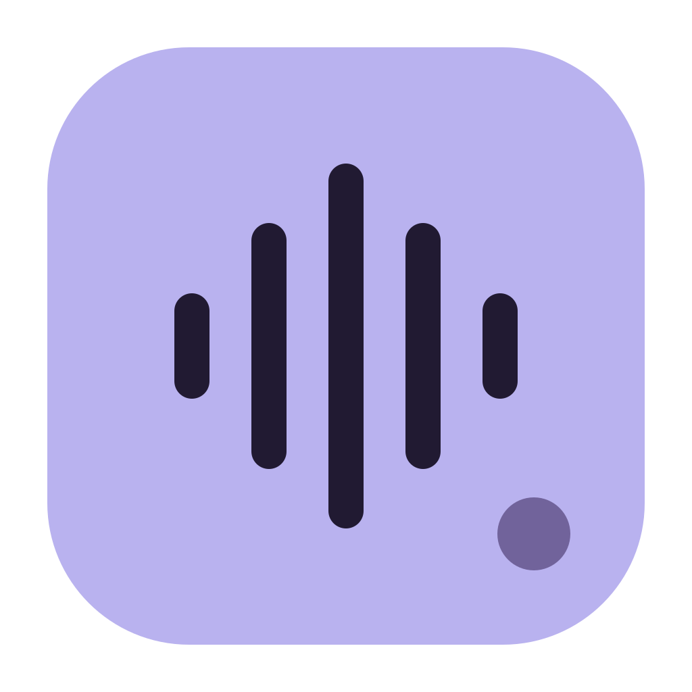
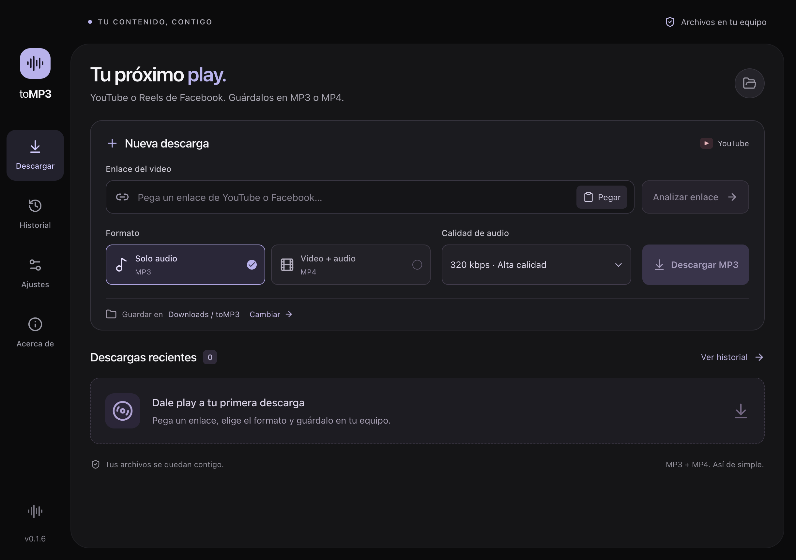

<p align="center">
  
</p>

<h1 align="center">toMP3</h1>

<p align="center"><strong>Tu próximo play.</strong><br />De YouTube y Facebook a tu equipo, en MP3 o MP4.</p>

<p align="center">
  <a href="https://github.com/rubent0rres/toMP3/releases/latest"></a>
  
  
</p>

<p align="center">
  <a href="#descargas">Descargar</a> ·
  <a href="#uso">Cómo usar</a> ·
  <a href="#iniciar-el-desarrollo">Desarrollo</a>
</p>

## Descargas

Elige el instalador para tu equipo. Incluye las herramientas de descarga y conversión; no necesitas instalar Node.js, Python ni FFmpeg para usar la app.

| Sistema | Descarga |
| --- | --- |
| **Windows de 64 bits** | [Descargar instalador .exe](https://github.com/rubent0rres/toMP3/releases/latest/download/toMP3-windows-x64.exe) |
| **Mac con Apple Silicon** · M1 o posterior | [Descargar .dmg para Apple Silicon](https://github.com/rubent0rres/toMP3/releases/latest/download/toMP3-macos-arm64.dmg) |
| **Mac con Intel** | [Descargar .dmg para Intel](https://github.com/rubent0rres/toMP3/releases/latest/download/toMP3-macos-x64.dmg) |

En Windows, ejecuta el instalador. En Mac, abre el DMG y arrastra **toMP3** a **Aplicaciones**. Puedes consultar la versión de tu procesador en el menú Apple → **Acerca de esta Mac**.

[Todas las versiones y archivos ZIP](https://github.com/rubent0rres/toMP3/releases) · [Comprobar las descargas con SHA-256](https://github.com/rubent0rres/toMP3/releases/latest/download/SHA256SUMS.txt)

Los instaladores aún no tienen firma digital ni notarización, por lo que Windows o macOS pueden mostrar un aviso al abrirlos.

## Tu contenido, contigo



| Audio a tu medida | Video listo para guardar | Archivos en tu equipo |
| --- | --- | --- |
| MP3 de 128 a 320 kbps | MP4 de YouTube y Reels públicos | Carpeta elegida por ti e historial local |

Aplicación de escritorio con **Electron + Next.js**, interfaz en español y sin servidor externo propio.

## Uso

1. Pega el enlace de un video y pulsa **Analizar enlace**.
2. Selecciona **Solo audio / MP3** o **Video + audio / MP4** y su calidad.
3. Cambia la carpeta de destino si lo necesitas y pulsa **Descargar**.
4. Consulta el progreso, cancela o reintenta descargas, o muestra los archivos terminados en Finder/Explorador.

Acepta Reels públicos de Facebook con enlaces `facebook.com/reel/ID`, `facebook.com/share/r/CODIGO/` y `fb.watch/CODIGO/`. Los enlaces móviles y los parámetros de compartir se normalizan. También acepta enlaces `youtube.com/watch`, `youtu.be`, Shorts, `live` y `embed` de un video individual. Si un enlace incluye una lista, solo se descarga el video seleccionado. Las listas completas y las transmisiones activas no están incluidas.

- MP3: 128, 192, 256 o 320 kbps. La calidad de la fuente limita la calidad del resultado.
- MP4 de Facebook: mejor calidad disponible, con video y audio. No se aplica un filtro de resolución porque Facebook puede omitir ese dato en sus pistas HD/SD.
- MP4 de YouTube: resolución máxima de 720p, 1080p, 1440p o 2160p; no se inventa una resolución superior a la fuente.
- Los MP4 se preparan con video H.264 de 8 bits y audio AAC-LC para facilitar su reproducción en QuickTime y los reproductores de Windows. Se conservan las pistas que ya son compatibles y se convierten las que lo necesitan. Los archivos se verifican antes de marcar la descarga como completada. La preparación puede tardar más en videos largos o de alta resolución.
- Cola de hasta 20 descargas pendientes, procesadas una a la vez.
- El motor se prepara en segundo plano al abrir la app. El análisis conserva sus resultados durante 10 minutos y las solicitudes simultáneas del mismo enlace comparten una sola consulta.
- Historial local de hasta 100 registros. Limpiarlo no elimina tus archivos.
- Los archivos existentes se conservan; se agrega un número al nombre cuando hace falta.
- Cancelar elimina los temporales de esa descarga. Si la aplicación se cierra abruptamente, el registro queda disponible para reintentar al abrir de nuevo; puede quedar un temporal en `.tomp3` dentro de la carpeta elegida.
- Los cambios de carpeta se aplican a las nuevas descargas. Las que ya están en cola conservan su destino.

El historial se guarda en `downloads.json`, dentro de la carpeta de datos de Electron para toMP3. La carpeta de destino inicial es `Descargas/toMP3`.

## Iniciar el desarrollo

Requiere Node.js 22.12 o posterior y acceso a internet durante la instalación.

```sh
npm ci
npm run dev
```

El primer inicio prepara yt-dlp, FFmpeg y FFprobe en `resources/bin/`. Los siguientes inicios reutilizan las herramientas locales después de comprobar que funcionan. Si falta FFmpeg tanto en las dependencias como en esa carpeta (por ejemplo, cuando se omiten los scripts de instalación), se descarga automáticamente al ejecutar `npm run dev` o `npm run tools:setup`. No hace falta instalar Python ni estas herramientas en el sistema. La descarga de yt-dlp se verifica con el SHA-256 publicado por el proyecto oficial. El servidor de desarrollo utiliza `127.0.0.1:3210`; Electron se cierra junto con él al detener el comando.

En macOS y Windows se incluye la distribución oficial de yt-dlp con sus archivos ya extraídos en `resources/bin/yt-dlp-runtime/`. Así se evita descomprimir el motor en cada análisis o descarga. La primera apertura puede tardar más por las comprobaciones del sistema; el tiempo de consulta también depende de YouTube, Facebook y la conexión.

## Abrir la versión compilada

```sh
npm run tools:setup
npm run build
npm start
```

`npm run dev:web` muestra solamente la interfaz en el navegador. Las descargas, el portapapeles y la selección de carpeta funcionan dentro de Electron.

## Verificación

```sh
npm run check
npm test
npm run test:e2e
```

La prueba integral abre Electron con un perfil aislado dentro de `work/smoke`, analiza un video público corto y descarga sus versiones MP3 y MP4. Requiere acceso a YouTube. Para probar un Reel real en la app ya empaquetada: `node scripts/smoke-electron.mjs --packaged --url https://www.facebook.com/reel/ID`. Las capturas y los archivos de prueba quedan en esa misma carpeta, separada del historial personal.

Las pruebas unitarias cubren validación de enlaces y opciones, serialización de la cola, nombres únicos, cancelación, limpieza de temporales, reintentos y recuperación de historial.

## Generar una aplicación

```sh
npm run pack   # Aplicación local sin instalador
npm run dist   # DMG/ZIP en macOS, NSIS en Windows, AppImage en Linux
```

Los resultados quedan en `release/`. Compila en el sistema y arquitectura de destino: las herramientas multimedia se seleccionan para la máquina que ejecuta `tools:setup`. Los instaladores de Windows y Mac se generan sin firma digital. Linux conserva su configuración de AppImage, pero no forma parte de la publicación ni de sus pruebas.

### Publicar una versión en GitHub

El flujo [Instaladores](https://github.com/rubent0rres/toMP3/actions/workflows/installers.yml) compila Windows x64, Mac arm64 y Mac Intel en equipos de GitHub con el sistema y arquitectura correspondientes. En cada uno ejecuta la compilación, revisión de tipos y estilos, pruebas unitarias y `npm run test:package`, que abre la app empaquetada y comprueba sus herramientas mediante conversiones locales a MP3 y MP4.

Para publicar una versión nueva desde una copia limpia del repositorio:

```sh
npm version patch
git push origin main
git push origin --tags
```

La etiqueta `vX.Y.Z` debe coincidir con `package.json`. Cuando los tres instaladores pasan la verificación, se publican juntos en GitHub Releases con sus sumas SHA-256. Los enlaces de descarga de este README apuntan siempre a la última versión. También puedes ejecutar el flujo manualmente desde Actions para obtener los instaladores como artefactos sin publicar una versión.

La app todavía no instala actualizaciones automáticamente; descarga la versión nueva desde Releases para actualizarla.

Para actualizar el motor de descarga:

```sh
npm run tools:setup -- --update
```

Después vuelve a compilar y empaquetar. Reinicia cualquier instancia que estuviera abierta para utilizar el motor nuevo.

## Estructura

- `app/`: interfaz de Next.js, TypeScript y estilos.
- `electron/main.cjs`: ventana, protocolo local, preferencias e IPC.
- `electron/preload.cjs`: API limitada entre la interfaz y Electron.
- `electron/downloader.cjs`: análisis, cola y procesos multimedia.
- `scripts/`: instalación de herramientas, desarrollo y prueba integral.
- `tests/`: pruebas de la cola y sus límites.
- `resources/bin/`: herramientas locales, excluidas de Git.

Next.js exporta una interfaz estática a `out/`. Electron la carga por el protocolo privado `tomp3://desktop`, con aislamiento de contexto, sandbox y Node deshabilitado en la interfaz. El proceso principal valida enlaces y opciones, inicia los programas sin un intérprete de comandos y limita las operaciones de archivos a la carpeta elegida y a descargas conocidas.

React y Next.js son dependencias de compilación: el paquete de escritorio contiene la interfaz compilada y los procesos de Electron, sin instalar un servidor Next.js en el equipo del usuario.

## Limitaciones y dependencias

YouTube y Facebook pueden limitar videos por región, acceso o verificación; en esos casos la aplicación muestra el error y permite reintentar. Esta versión no importa cookies ni inicia sesión en YouTube o Facebook. Los Reels privados o que pidan iniciar sesión no se pueden descargar; se muestra un mensaje específico de Facebook. Utiliza contenido propio o para el que tengas permiso de descarga.

La revisión inicial de `npm audit` detectó avisos transitivos en las herramientas de desarrollo `eslint-config-next` (braces) y `electron-builder` (sprintf-js), sin corrección compatible publicada en esas dependencias en el momento de la revisión. No se incluyen esos módulos en la aplicación empaquetada. Revisar de nuevo antes de publicar una distribución.

Fuentes y licencias de terceros:

- [Electron](https://www.electronjs.org/): MIT.
- [Next.js](https://nextjs.org/): MIT.
- [yt-dlp](https://github.com/yt-dlp/yt-dlp): consultar sus avisos y los componentes de la distribución binaria.
- [FFmpeg](https://ffmpeg.org/legal.html), [ffmpeg-static](https://github.com/eugeneware/ffmpeg-static) y [FFprobe installer](https://github.com/SavageCore/node-ffprobe-installer): las licencias dependen de las opciones de compilación del binario. Los avisos de los distribuidores y las referencias a sus fuentes se incluyen junto con las herramientas en la app; consulta también [resources/THIRD_PARTY.md](resources/THIRD_PARTY.md).
